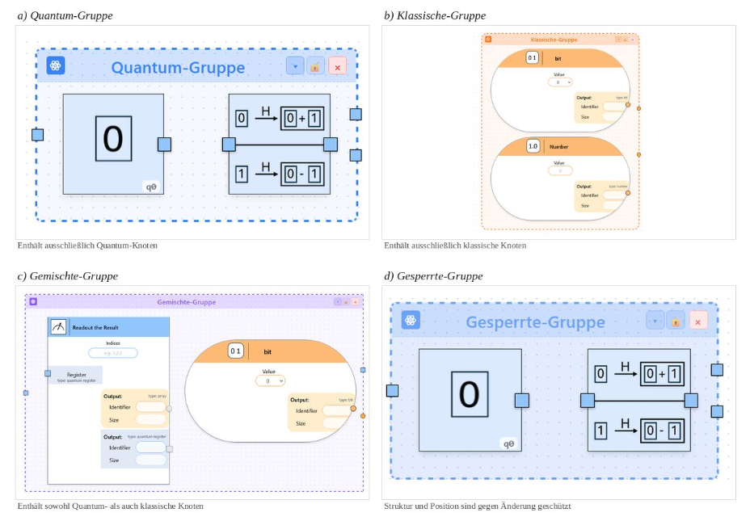

Grouping of Modeling Constructs
-------------------------------

Related parts of a circuit can be combined into a group, which can be collapsed
and expanded as a single unit. This reduces the visual complexity of larger
models and allows individual parts of a circuit to be analyzed separately.

To create a group, several nodes are selected first. The **lasso mode** is
activated through the lasso button in the canvas toolbar and allows multiple
nodes to be selected by dragging a selection area around them. The selected
nodes are then combined into a group.

The following group features are available:

- **Semantic group types**: When a group is created, its type is determined
  automatically from the contained child nodes. Groups containing only quantum
  operations are classified as *quantum*, groups containing only classical
  operations as *classical*, and groups containing both as *mixed*. Each type
  is distinguished by its own border color and corner shape, so the content of
  a group can be recognized without opening it.

- **Locking**: Independently of its semantic type, a group can be locked. A
  locked group is protected against changes to its internal structure and its
  position on the canvas, and is displayed with a less transparent background.
  Collapsing, expanding and dissolving the group remain possible.

- **Nested groups**: Groups can themselves be part of a superordinate group,
  which allows circuits to be structured across several levels of abstraction.

- **Duplication**: Existing groups can be duplicated and reused at another
  position within the same model.

- **Dissolving**: When a group is dissolved, the contained child nodes are
  transferred back into the surrounding model and their connections are
  restored. The relative positions of the child nodes are preserved.

Connections between a group and the surrounding circuit are represented through
proxy handles at the border of the group node, so the internal structure of the
group stays encapsulated while the existing connections are preserved.

