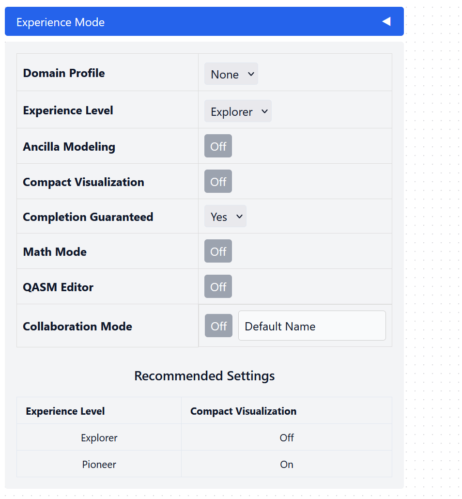

Math Mode
---------

The Math Mode links the visual circuit representation to its underlying
mathematical state description.

The Math Mode is disabled by default. To enable it, open the **Experience
Mode** panel and set **Math Mode** to *On*. The **Math Mode** tab then becomes
available in the panel on the right-hand side of the modeler, next to
**Properties** and **QASM**.

The panel can be updated at any time using the **Refresh** button, which sends
the current model to the backend and recalculates the corresponding
representations.

The following representations are available:

- **Dirac Notation**: Shows the resulting quantum state of the modeled circuit
  in Dirac notation. The state is recalculated whenever the circuit is changed
  and refreshed.

- **Steps**: Shows the intermediate states of the circuit. For every gate, the
  resulting state vector is calculated separately and displayed as its own
  derivation step, together with the applied operation.

- **Histogram**: Displays the measurement probabilities of the resulting state.

- **Bloch**: Shows the state of a single qubit as an interactive
  three-dimensional Bloch sphere. The sphere can be rotated freely with the
  mouse. For circuits with several qubits, the displayed qubit is selected
  through the qubit selection.

- **Properties**: Indicates whether the current state is entangled or
  persistent.

Linking Steps and Circuit Elements
----------------------------------

Each derivation step in the **Steps** view is linked to the circuit element it
originates from. Selecting a step highlights all canvas nodes that contributed
to the displayed state up to and including this step, so the highlighting
covers the complete derivation path rather than only the directly associated
gate. The highlighting is temporary and disappears automatically, which avoids
a permanent visual overlay when steps are selected repeatedly. If a highlighted
node is contained in a group, only the affected child node is highlighted while
the group itself remains unchanged.

AI Explanation
--------------

The **Explain** button generates a textual interpretation of the state
evolution in natural language. The explanation is based on the initial state,
the individual state changes and the applied quantum operations of the modeled
circuit, and is displayed directly below the derivation steps.

The explanation requires access to the Mistral API. The corresponding API key
is configured through the environment configuration of the frontend.

Exporting Mathematical Representations
--------------------------------------

The Math Mode panel provides several export formats through the **Export** and
**Export all** buttons:

- **Copy as LaTeX or Unicode**: Copies the Dirac notation directly as LaTeX
  source or as Unicode text.

- **main.tex**: Exports a complete LaTeX document that can be used in Overleaf
  without further adjustments. It contains the required package imports, the
  derivation steps, the corresponding matrix definitions and a table of the
  measurement probabilities. The configuration needed to include the circuit
  image is already part of the document, so the separately exported
  ``circuit.png`` can be added without changes.

- **dirac_export.zip**: Contains the mathematical representations together with
  the normalized ``circuit.qasm`` file and a JSON representation of the
  circuit, so that both the mathematical description and the underlying circuit
  representation can be reused outside the tool.
